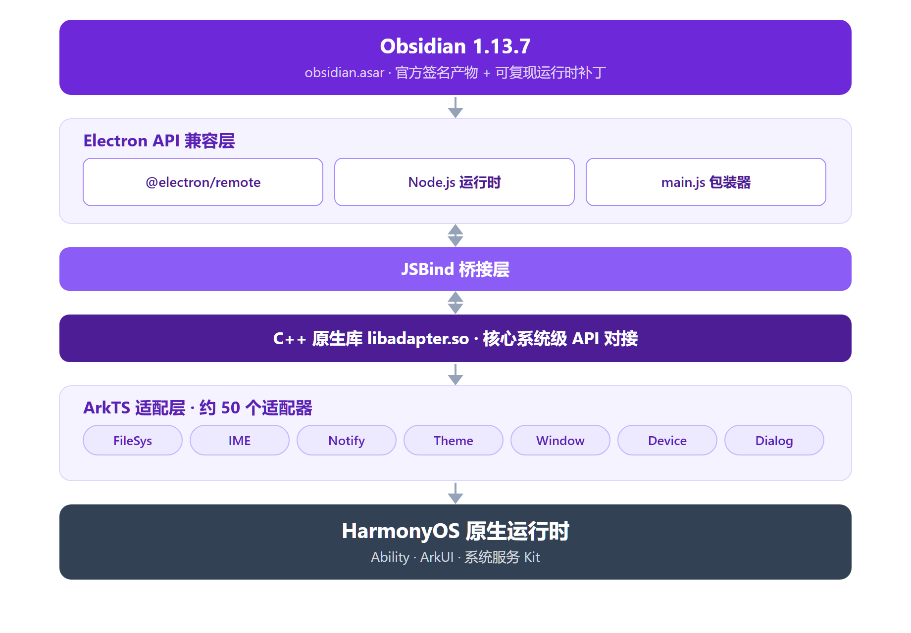

# 技术架构

> 本文承接原 README 的技术细节：分层架构、模块划分、适配层与目录结构。面向想读源码或改适配层的开发者；只想安装使用的读者看 [README](../README.md) 即可。

## 总览



*图：OHsidian 分层架构。图中已省略华为账号与云存储相关组件（本 Fork 移除）。*

**分层说明**（自上而下）：

- **Obsidian 层**：官方 obsidian-1.13.7.asar 签名产物（下载时做 SHA-256 与官方 RSA-SHA256 校验），经 `scripts/update-obsidian.mjs` 补丁管线注入运行时兼容补丁（IPC 守卫、`obsidian://` 深链桥、触摸模式适配、默认仓库重定向、回收站重定向与 30 天清理、CLI 服务套接字重定向、自动更新关闭）；笔记编辑核心未改动。Obsidian 为专有软件，版权归其权利人所有，本仓库与其无任何关联。
- **Electron 兼容层**：`@electron/remote` 提供 remote 模块 API，`main.js` 负责加载 asar 与更新管理。
- **JSBind 桥接层**：连接 JS 运行时与 ArkTS 原生层，把 Electron API 调用转发到对应的适配器。
- **C++ 原生库**：`libadapter.so` 提供核心系统级 API 对接。
- **ArkTS 适配层**：约 50 个适配器，把 HarmonyOS API 包装为 Electron 兼容接口。
- **HarmonyOS 底层**：系统原生能力，包括 Ability 组件、ArkUI 界面等（华为账号与云存储已在本 Fork 移除）。

## 模块结构

项目采用 HarmonyOS 标准双模块架构。

### `web_engine`（HAR 静态库）

核心引擎模块，提供所有 Electron 兼容功能和适配层，可被其他 HarmonyOS 应用复用。

```typescript
// 公共导出（Index.ets）
export { WebAbilityStage } from './src/main/ets/application/AbilityStage'
export { WebAbility } from './src/main/ets/ability/WebAbility'
export { WebEmbeddedAbility } from './src/main/ets/ability/WebEmbeddedAbility'
export { WebWindow, WebSubWindow, WebEmbeddedWindow, WebWindowNode } from './src/main/ets/components/...'
export { WebChildProcess } from './src/main/ets/process/WebChildProcess'
```

依赖注入使用 InversifyJS 管理约 50 个适配器的单例注册：

```text
CommonModule  → AbilityManager, DragParamManager, SystemFloatingWindowManager
AdapterModule → ContextAdapter, DragDropAdapter, MultiInputAdapter,
                NativeThemeAdapter, PermissionManagerAdapter, DialogAdapter,
                TrashAdapter, CloudSyncAdapter ...
```

### `electron`（HAP 入口包）

可执行的应用模块，包含所有 UI 页面和应用逻辑。

**Ability 组件：**

| Ability | 页面 | 用途 |
|---------|------|------|
| `EntryAbility` | Index.ets | 主入口（本 Fork 已移除华为云 / AGC 初始化） |
| `BrowserAbility` | WindowNode.ets | 浏览器进程窗口 |
| `StatelessAbility` | Index.ets | 无状态窗口 |
| `BrowserEmbeddedAbility` | EmbeddedWindow.ets | 嵌入 UI |
| `StatusBarEntryAbility` | StatusBarPage.ets | 状态栏扩展 |

**UI 页面：**

| 页面 | 说明 |
|------|------|
| `Index.ets` | 主界面，承载 `WebWindow` 组件 |
| `WindowNode.ets` | 浏览器窗口节点 |
| `SubWindow.ets` | 子窗口（弹窗、设置等） |
| `EmbeddedWindow.ets` | 嵌入式窗口 |
| `Login.ets` | 华为账号登录页（本 Fork 已停用，无入口） |
| `StatusBarPage.ets` | 状态栏页面 |
| `WebPage.ets` | 隐私协议等 WebView 页面 |

## 适配层

适配层是 OHsidian 最重要的基础设施：它把 HarmonyOS 原生 API 包装为 Electron 兼容的调用接口，使 Obsidian 在毫无感知的情况下运行在 HarmonyOS 上。

### 适配器清单

每个适配器都继承自 `BaseAdapter`，通过 InversifyJS 注册为单例，并配有对应的 JSBind 绑定类：

```text
web_engine/src/main/ets/adapter/
├── Accessibility.ets           # 无障碍功能
├── AppLifecycle.ets            # 应用生命周期
├── AppWindow.ets               # 应用窗口操作
├── Battery.ets                 # 电池状态
├── Bluetooth.ets               # 蓝牙经典
├── BluetoothLowEnergy.ets      # 低功耗蓝牙
├── BrowserPolicy.ets           # 浏览器安全策略
├── CertManager.ets             # 证书管理
├── CloudSync.ets               # 华为云同步（本 Fork 已停用，未接线）
├── Context.ets                 # 应用上下文
├── ContextPath.ets             # 文件路径解析
├── Cursor.ets                  # 自定义光标
├── Device.ets                  # 设备信息
├── DeviceInfo.ets              # 硬件信息
├── DeviceUserAuth.ets          # 生物识别
├── Dialog.ets                  # 原生对话框
├── Display.ets                 # 显示器管理
├── DragDrop.ets                # 拖拽放置
├── ElectronApp.ets             # Electron App API
├── ExternalProtocol.ets        # 外部协议处理
├── FileManager.ets             # 文件管理
├── FilePicker.ets              # 文件选择器
├── Font.ets                    # 系统字体枚举
├── Geolocation.ets             # 地理位置
├── I18n.ets                    # 国际化
├── IMF.ets                     # 输入法框架
├── Media.ets                   # 媒体播放
├── MimeType.ets                # MIME 类型
├── MultiInput.ets              # 多窗口输入
├── NativeTheme.ets             # 系统主题
├── NetConnection.ets           # 网络连接
├── Notification.ets            # 系统通知
├── Ocr.ets                     # OCR 识别
├── PasteBoard.ets              # 剪贴板
├── PermissionManager.ets       # 权限管理
├── PopupWindow.ets             # 弹出窗口
├── PowerMonitor.ets            # 电源监听
├── Print.ets                   # 打印服务
├── Process.ets                 # 进程管理
├── RunningLock.ets             # 唤醒锁
├── ScreenlockMonitor.ets       # 锁屏监听
├── Screenshot.ets              # 屏幕截图
├── ShapeDetection.ets          # 形状检测
├── Speech.ets                  # 文字转语音
├── StatusBar.ets               # 状态栏控制
├── SubWindow.ets               # 子窗口管理
├── SystemFloatingWindow.ets    # 系统悬浮窗
└── Trash.ets                   # 回收站操作
```

### JSBind 绑定机制

每个适配器配有一个 Bind 类，把方法注册到 JS 运行时：

```typescript
// 示例：CloudSync 适配器的 JSBind 注册
JsBindingUtils.bindFunction("CloudSync.uploadFile", cloudSyncAdapter.uploadFile)
JsBindingUtils.bindFunction("CloudSync.downloadFile", cloudSyncAdapter.downloadFile)
JsBindingUtils.bindFunction("CloudSync.listCloudFiles", cloudSyncAdapter.listCloudFiles)
// ...
```

所有绑定在应用启动时通过 `JsBindingMethod.ets` 统一激活。

## 项目结构

```text
OHsidian/
├── AppScope/                         # 全局应用配置
│   ├── app.json5                     # bundleName、版本、多实例模式
│   └── resources/base/
│       ├── element/string.json       # 应用名称 "OHsidian"
│       ├── media/                    # 应用图标（startIcon、trayIcon）
│       └── profile/                  # 字体缩放配置
│
├── web_engine/                       # HAR 静态库（核心引擎）
│   ├── Index.ets                     # 公共 API 导出
│   ├── childProcess.ets              # 子进程导出
│   ├── oh-package.json5              # 依赖：inversify、reflect-metadata
│   ├── hvigorfile.ts                 # harTasks 构建
│   └── src/main/
│       ├── ets/
│       │   ├── ability/              # WebAbility、WebEmbeddedAbility 基类
│       │   ├── adapter/              # 约 50 个系统适配器
│       │   ├── application/          # AbilityStage
│       │   ├── common/               # DI 容器、常量、管理器
│       │   ├── components/           # WebWindow、WebSubWindow 等 UI 组件
│       │   ├── interface/            # TypeScript 接口定义
│       │   ├── jsbindings/           # JSBind 绑定注册
│       │   ├── process/              # ChildProcess 管理
│       │   └── utils/                # 日志、工具函数
│       ├── cpp/types/libadapter/     # C++ 原生库类型声明
│       └── resources/resfile/resources/app/
│           ├── main.js               # Electron 启动入口
│           ├── package.json          # Obsidian 1.13.7 包装配置（版本即 asar 拉取钉子）
│           └── obsidian.asar         # Obsidian 应用包（不入库，构建时自动生成）
│
├── electron/                         # HAP 入口模块
│   ├── oh-package.json5              # 依赖：web_engine（AGC hmcore 已移除）
│   ├── hvigorfile.ts                 # hapTasks 构建
│   └── src/main/
│       ├── module.json5              # 模块清单（Ability、页面、权限）
│       ├── ets/
│       │   ├── Application/          # MyAbilityStage
│       │   ├── entryability/         # Entry、Browser、Stateless Ability
│       │   ├── extensionAbility/     # EmbeddedAbility、StatusBar
│       │   ├── pages/                # UI 页面
│       │   └── process/              # CustomChildProcess
│       ├── resources/
│       │   ├── base/element/         # 字符串资源
│       │   ├── base/profile/         # main_pages 路由配置
│       │   ├── rawfile/              # （AGC 配置已随云功能移除）
│       │   └── zh_CN|en_US/element/  # 国际化字符串
│       └── ohosTest/                 # 单元测试
│
├── hvigor/                           # Hvigor 构建配置
├── hvigorfile.ts                     # 根构建文件（appTasks）
├── build-profile.json5               # 构建配置（签名、SDK、模块）
├── oh-package.json5                  # 根包配置
└── oh-package-lock.json5             # 依赖锁定文件
```

## 依赖说明

### 运行时依赖

| 依赖 | 版本 | 说明 |
|------|------|------|
| `inversify` | ^6.0.1 | IoC 容器，管理适配器依赖注入 |
| `reflect-metadata` | ^0.1.13 | TypeScript 装饰器元数据 |
| `@electron/remote` | ^2.1.3 | Electron remote 模块兼容 |
| `libadapter.so` | — | C++ 原生适配库（本地引用） |
| `btime` | — | 文件时间处理 |
| `get-fonts` | — | 系统字体枚举 |

### 开发依赖

| 依赖 | 版本 | 说明 |
|------|------|------|
| `@ohos/hypium` | ^1.0.6 | HarmonyOS 测试框架 |
| `@ohos/hvigor-ohos-plugin` | — | Hvigor 构建插件 |
